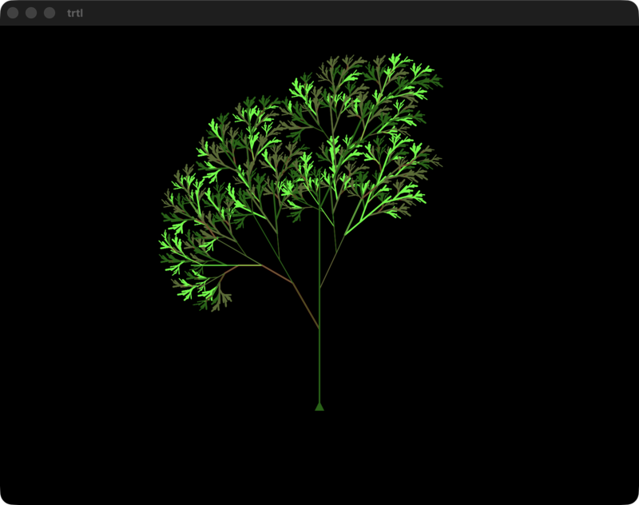

# Trtl - Simple Ruby Turtle Graphics

> [!NOTE]
> Trtl originally drew its graphics with Tk, which shipped with Ruby until Ruby 2.4 moved it out of the standard library and into a separate `tk` gem. That gem has to be compiled against a Tcl/Tk installation, which made Trtl a pain to set up, particularly on macOS. In 2026, Trtl was ported to [LibUI](https://github.com/kojix2/LibUI), whose gem includes a precompiled native library for macOS, Windows and Linux, so on most systems `gem install` is all it takes.

## Installation

    gem install trtl

## Description

Trtl is a simple 'turtle' system inspired by Python's turtle.py. It provides simple turtle drawing capabilities in Ruby, even if you're just at an IRB prompt. It draws using [LibUI](https://github.com/kojix2/LibUI).

## Usage

If Trtl detects you're in an IRB or Pry session, it'll automatically make turtle
methods available directly at the prompt. For example:

    $ irb
    > require 'trtl'
    > forward 100
    # At this point, a window appears with the turtle

If you wish to use Trtl from a regular Ruby script, you have a few options. You
can create a Trtl instance and use it directly:

    require 'trtl'
    t = Trtl.new
    10.times { t.left(24); t.forward(30); t.ensure_drawn }
    t.wait # keeps the window open until it's closed or Enter is pressed

You can use Trtl's `run` method to use it in a more interactive fashion:

    Trtl.new.run { 10.times { left(24); forward(30); ensure_drawn }; wait }

Or you can include InteractiveTurtle and get a similar effect as if you were in
IRB:

    include InteractiveTurtle
    10.times { left(24); forward(30) }
    wait

Note: Using InteractiveTurtle makes drawing slower as it ensures all graphics
are drawn after every action (as necessary for IRB use).

## Commands

Only a small number of commands are currently implemented, but they're enough for the major actions:

* `title(title_name)`
* `forward(distance)` - aliased as `fd`
* `back(distance)` - aliased as `bk` and `backward`
* `left(angle)` - aliased as `lt` and `turnleft`
* `right(angle)` - aliased as `rt` and `turnright`
* `pen_up` - aliased as `pu` and `up` and `penup`
* `pen_down` - aliased as `pd` and `down` and `pendown`
* `color(color_name)` - aliased as `pencolor`. Accepts X11 color names (`"darkolivegreen"`) or hex (`"#1e90ff"`), and returns the current color if called with no argument
* `move(x, y)` - aliased as `goto`, `setpos` and `setposition`
* `home` - returns to the center of the canvas, facing right
* `position` - aliased as `pos`
* `circle(radius, extent = 360, steps = 360)`
* `dot(size)` - draws a dot, defaults to a sensible size but you can supply if you want
* `is_drawing?`
* `width(width_in_pixels)`
* `ensure_drawn` - makes sure everything drawn so far is on screen (useful in loops in scripts)
* `wait` - keeps the window open until it's closed or Enter is pressed (needed at the end of scripts, not in IRB)

## Examples

The examples in the `examples` folder should be reasonably illustrative. If you
try any of them, try `example4.rb` - it renders an awesome looking tree.

## Credits

* turtle.py for inspiration (in the 'Ruby needs this!' sense)
* Some of the examples taken from examples for an earlier Ruby turtle found at http://www.rubyquiz.com/quiz104.html

## Copyright and License

Copyright (c) 2012-2026 Peter Cooper (other than minor parts of some samples.)

MIT licensed. See LICENSE.md
